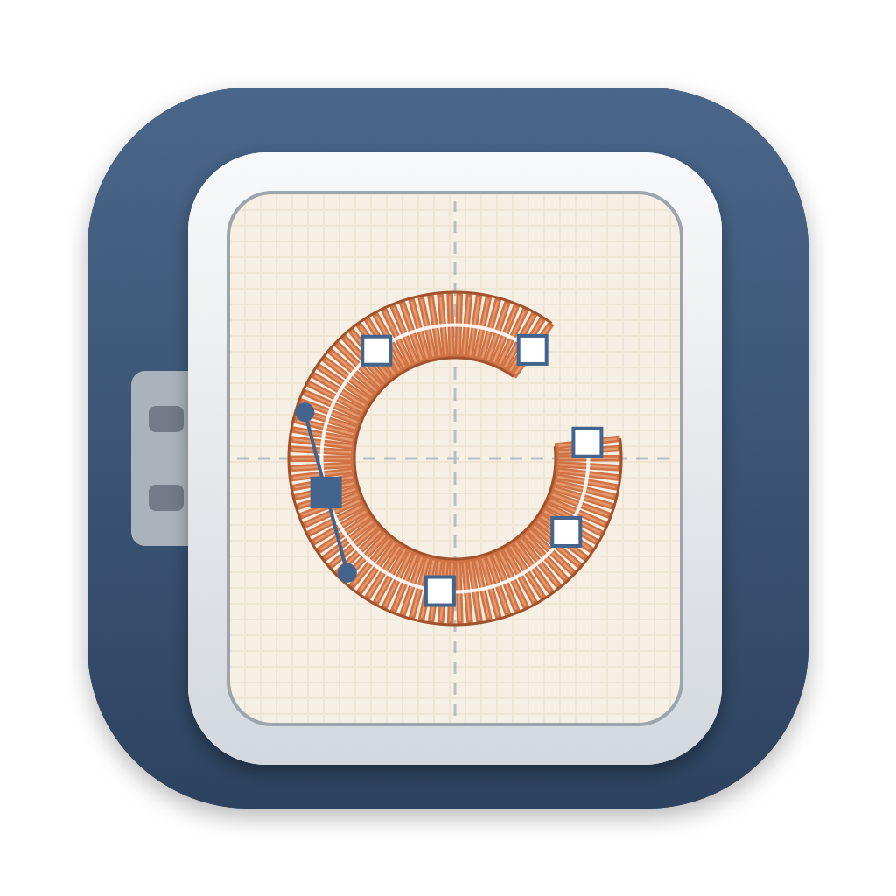

<p align="center"></p>

<h1 align="center">OpenHoop</h1>

<p align="center"><strong>Open-source machine embroidery for the Mac.</strong><br>
Digitize logos, patches and lettering into stitch files for your embroidery machine.</p>

<p align="center"><a href="https://openhoop.app"><strong>openhoop.app</strong></a> · <a href="https://github.com/EvenDog/openhoop/releases/latest">Download for Mac</a> · <a href="docs/USER-GUIDE.md">User guide</a></p>


> **In active development.** OpenHoop works end to end, from artwork to a machine file, and its designs have been sewn on a Brother SE600. Stitch settings keep improving from version to version. Test-stitch on scrap fabric before using a design on anything that matters.

## What it does

- **Draw stitches** over your artwork: running stitch (single or bean) and line styles (zigzag, blanket, back, stem, motif, ripple); satin columns, edge by edge or from one center line, with sharp corners mitred or capped; and fills: tatami (with 26 textures), contour, radial, wave, stipple, motif, cross stitch, gradient, satin, and fills that turn along stitch angle lines or follow a guide line, all with holes.
- **Bring in artwork**: trace a PNG or JPEG, import SVG outlines, or auto-digitize simple artwork into fills.
- **Lettering** with 18 bundled embroidery fonts or any font on your Mac: straight, arched, on a line you draw, or bent into an envelope (bridge, pennant, perspective, diamond). **Monograms**: one to three initials in classic layouts, with ornaments and a satin border.
- **Familiar editing tools**: knife, weld and smooth shapes; branching (touching shapes sew in one go, without trims); remove overlaps; outlines and offsets; wreaths and kaleidoscopes; edit individual needle points; align, space evenly, skew, and sew in the order you click.
- **Patch tools**: satin borders and appliqué (placement line, tack-down and satin edge, with stops).
- **Sews well**: two underlay layers per shape (including double zigzag and crossed tatami), pull compensation, short stitches on curves, split wide satin, start and end points, travel kept inside shapes, and stops at jumps for machines without a thread cutter.
- **Fabric presets** for woven, knit, towel, denim and felt, with the stabilizer to use, plus a basting box and laydown to hold the fabric.
- **See it before it sews**: Thread View draws every stitch as real thread, a stitch player sews it on screen (and can pause at each trim, like the machine), Review Sewing Order steps through every start, end and move and flags long ones, and a density map shows where thread piles up. Test swatches sew a setting at several values side by side.
- **Real threads**: Brother, Janome and Husqvarna Viking machine palettes and 21 thread-brand charts (Madeira, Isacord, Sulky, Robison-Anton, Floriani and more) built in, or import any chart.
- **Hoops** for Brother, Baby Lock, Janome, Elna, Husqvarna Viking / Pfaff, Bernina and Singer machines, plus hoops of your own saved by name, and **multi-hooping** for designs bigger than your hoop, with alignment marks and a hooping sheet.
- **Machine files**: export PES, PEC, DST, EXP, JEF, VP3 and XXX (each one read back and checked before saving), and import them too.
- **Production worksheet** to print and keep beside the machine: thread steps, stops and an actual-size picture.
- **Made for the Mac**: every tool one click away, a precision bar for exact position, size and rotation, light and dark mode, dockable panels, copy and paste, undo, millimeters or inches, tooltips that explain every tool, a keyboard shortcut you can change for every command, and automatic updates.

New to machine embroidery software? The [user guide's Getting started](docs/USER-GUIDE.md#getting-started) walks through a first sew-out, with which file format your machine needs.

## Download

Get the DMG from the [latest release](https://github.com/EvenDog/openhoop/releases/latest), open it and drag **OpenHoop** onto **Applications**. It's signed and notarized by Apple, so it opens like any other app.

## Requirements

- macOS 14 (Sonoma) or later on an Apple Silicon Mac
- To build: Xcode or the Swift 6 toolchain, and Python 3

## Build and run

```sh
git clone https://github.com/EvenDog/openhoop.git
cd openhoop
./scripts/build.sh      # builds dist/OpenHoop.app (the first run sets up a local Python environment)
open dist/OpenHoop.app
```

Run the tests with `./scripts/test.sh` (build first: some tests use the built app).

## Documentation

- **[User guide](docs/USER-GUIDE.md)**: every tool and setting in detail, file formats, and known limits.
- **[Developing OpenHoop](docs/DEVELOPMENT.md)**: how the code is organized and what the tests cover.

## License

OpenHoop is free software: you can redistribute it and/or modify it under the terms of the GNU General Public License as published by the Free Software Foundation, either version 3 of the License, or (at your option) any later version. It is distributed in the hope that it will be useful, but WITHOUT ANY WARRANTY; without even the implied warranty of MERCHANTABILITY or FITNESS FOR A PARTICULAR PURPOSE. See [LICENSE](LICENSE) for the full text.

Copyright © 2026 EvenDog.

Bundled parts keep their own licenses: pyembroidery (MIT), Clipper2 (Boost Software License), the Python runtime (PSF License), and the embroidery fonts in `Resources/EmbroideryFonts` (SIL Open Font License 1.1 or public domain; each font folder has its own `LICENSE`). The thread charts in `Resources/ThreadCharts` are pyembroidery's machine palettes (MIT) and brand charts from Ink/Stitch (GPL-3, like OpenHoop). See `Resources/ThirdPartyNotices.txt`.
